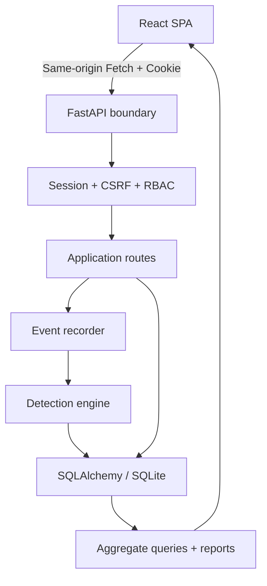

# Architecture

SENTINEL is a modular monolith for one security workspace. The browser displays server-owned data; neither metrics nor authorization decisions are trusted to the client.

## Request boundary

`config.py` validates environment combinations. `main.py` checks exact origins; `middleware.py` buffers at most 16 KiB of mutation body through the public ASGI receive protocol before JSON parsing, rejects invalid hosts, adds security headers and serves the built SPA from the same origin. Validation errors omit Pydantic's raw input. Unexpected exceptions return a generic response; diagnostic logging records only the exception class.

`principal` hashes the opaque session cookie and looks it up in `sessions`, rejects expired/idle/inactive sessions, applies per-user rate limiting, validates CSRF on mutations and refreshes stored activity at most once per 30 seconds with a conditional UPDATE. Idle expiry may occur up to 30 seconds earlier than exact per-request activity. The `/auth/me` dependency performs the same validity checks but omits audit events/counter writes for anonymous or invalid sessions. `admin` extends this dependency with role enforcement and records denied privilege attempts. Roles are read from the database, not a browser claim.

## Event and alert transaction

`record_event` applies a metadata allowlist, assigns a timestamp and event severity, inserts an event, and evaluates relevant enabled rules within the route's transaction. Failed logins are committed before an HTTP 401 is returned. Alerts, initial history and evidence are committed together with their triggering event. Subsequent changes use a conditional SQL update against the prior `updated_at` timestamp; stale edits return 409.

The original pure `detect_repeated_failures` function remains, wrapped by the persistent engine. SQL queries restrict correlation by time, type, source and demo/live partition. Rules run synchronously for this small lab; a larger ingestion stream should use a queue and dedicated workers.

## Data separation and semantics

- Live records are actual application events. The app does not monitor other computers, sniff traffic or import arbitrary customer logs.
- Demo records are synthetic database rows generated through the same recorder/detector. The UI defaults to live; the demo selector is available only in development with demo enabled.
- All database timestamps use UTC without embedded timezone for consistent SQLite/PostgreSQL behavior. API timestamps carry `Z`. UI timestamps use the viewer's locale; daily charts explicitly aggregate in UTC.
- Work-hour detection converts successful login time to the configured IANA timezone (default Asia/Bangkok).
- Dashboard “high-risk events” counts high/critical **event severity**. It is different from the alert-severity distribution.
- Resolution rate is resolved alerts divided by all alerts **created in the selected rolling period**. It is not an SLA or measure of confirmed attacks prevented.

## Storage and operations

Eight application tables plus Alembic version tracking. SQLite enables foreign keys and WAL. Atomic upsert counters share throttling state across application workers, but SQLite remains a small-lab choice with serialized writes. Coalescing session activity does not remove the authenticated-request rate-counter write/commit; it reduces session UPDATE statements only. SQLAlchemy and Psycopg permit a PostgreSQL configuration, whose runtime and migration behavior still need dedicated testing.

Migration 0001 represents the original schema. 0002 adds the Standard model and backfills legacy evidence. 0003 adds explicit rule parameters and migrates AUTH-003 scope/fingerprints to workspace. SQLite batch migrations temporarily disable FK enforcement for table reconstruction, then perform `foreign_key_check`; execute migrations offline with a backup. Downgrade is intentionally unsupported to avoid silently discarding investigation data.

Serve the built frontend and API together for simple cookie/CSRF behavior. Vite's development proxy supports local hot reload. The optional Docker configuration builds the same application and binds its published port to loopback. Hosted Cloudflare Workers cannot directly run this Python FastAPI process; this release was not published as a fake static dashboard.

## Scaling decisions and next steps

Separate ingestion from interactive APIs; replace synchronous correlation with queued workers; add trusted collectors and signed ingestion; use PostgreSQL with proper connection sizing; introduce MFA or institutional SSO; ship events to append-only storage; add retention/backup jobs and monitor application errors. Measure load first. No throughput, availability or production-security guarantee has been established.
