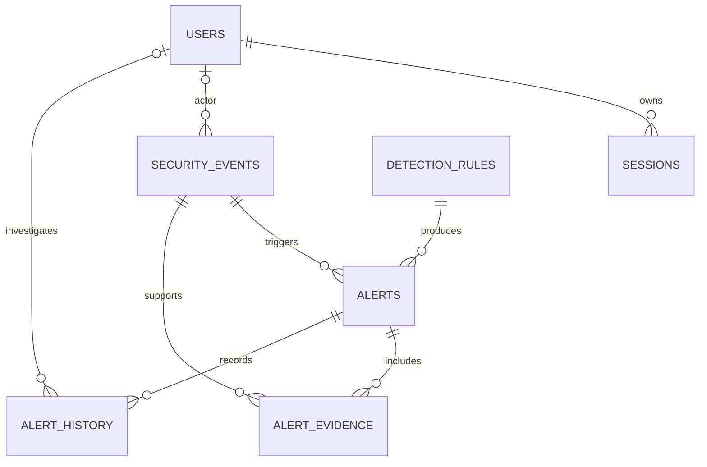

# Database schema

The authoritative schema is defined by `backend/migrations/versions/`. `schema.sql` is a SQLite schema snapshot from the migrated database, without data.

| Table | Key / purpose | Relationships and constraints |
| --- | --- | --- |
| users | Integer `id`; unique indexed username | Role check: admin/analyst; password hash; active flag; creation time |
| sessions | Integer `id`; unique SHA-256 `token_hash` | User FK with cascade; CSRF token; created, last seen, expiry; indexes on user and expiry |
| security_events | Integer `id` | Optional user FK; type, source IP, timestamp, metadata JSON, severity, demo flag; severity check |
| detection_rules | String `id` such as AUTH-001 | Name, description, threshold, window, enabled, severity and timestamp; positive threshold/window and optional parameter constraints; `max_attempts_per_account`, `min_accounts`, `min_source_ips`, required for their corresponding rules |
| alerts | Integer `id`; unique `dedup_key` | Trigger event FK and rule FK; subject, severity/status checks, created/updated/resolved, demo partition |
| alert_evidence | Composite `(alert_id, event_id)` PK | Alert and event FKs; preserves all linked evidence up to configured cap |
| alert_history | Integer `id` | Alert FK, optional actor FK; old/new status, note and timestamp; indexed alert ID |
| rate_buckets | Hashed scoped `key` PK | Hit count and indexed expiry; no raw username or session token |

Event indexes support type/time, source/time and live/demo filtering. Alert indexes support partition/status/created-time queries. Account deletion is not exposed; disabling a user retains attributable audit history and revokes sessions. Alert history cannot be edited/deleted through the API. Database administrators can still alter data; these are not cryptographically tamper-proof records.

Legacy v0.1 rows are retained and labeled demo, because the only original ingestion path was the unauthenticated demo API. Nonempty migration tests assert preserved IDs, evidence/history counts, schema convergence and foreign-key validity.
